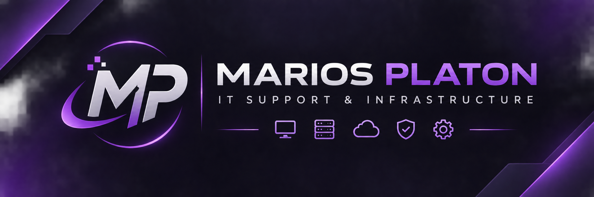

[](https://cv.mariosplaton.gr/)

# Marios Platon — IT Support Portfolio

**IT Support Technician · L1/L2 Helpdesk · Windows & Active Directory**

My professional portfolio brings together my work experience, technical skills, selected projects and personal home lab.

**[Explore the portfolio →](https://cv.mariosplaton.gr/)**  
[English CV](https://cv.mariosplaton.gr/cv-en.html) · [Ελληνικό βιογραφικό](https://cv.mariosplaton.gr/el/cv.html) · [Contact](https://cv.mariosplaton.gr/contact.html)

## Professional background

I work in end-user support, troubleshooting Windows workstations, applications, drivers, printers and peripherals. My role includes user administration in Active Directory and Microsoft 365, along with basic VM operations in VMware vSphere.

I combine practical technical support with customer service experience and an interest in infrastructure technologies.

## Explore my work

- **[Experience & skills](https://cv.mariosplaton.gr/index.html#experience)** — professional IT support experience, volunteering, education and certifications.
- **[Home lab](https://cv.mariosplaton.gr/homelab.html)** — a personal Proxmox learning environment exploring TrueNAS, Pi-hole, Uptime Kuma, Matrix / Element and Cloudflare Tunnel, with AI-assisted configuration and deployment.
- **[Selected projects](https://cv.mariosplaton.gr/index.html#projects)** — including collaborative Unity game development at Global Game Jam 2024.

## About this project

This repository contains the source for the portfolio website:

- English and Greek content, with matching language links.
- Responsive desktop and mobile layouts.
- Browser-friendly CV pages with print / save-as-PDF support.
- An interactive terminal for exploring the portfolio.
- Keyboard-accessible navigation and reduced-motion support.

Built with **HTML, CSS and JavaScript**, hosted on **GitHub Pages**, and developed and refined with AI assistance.

---

**[View the live portfolio](https://cv.mariosplaton.gr/)** · **[Get in touch](https://cv.mariosplaton.gr/contact.html)**

<details>
<summary>Development & maintenance</summary>

### Structure

- `index.html` and `el/index.html`: English and Greek homepages.
- `projects/` and `el/projects/`: project pages.
- `assets/`: images and CV files.
- `style.css`, `script.js` and `terminal.js`: shared styling and behaviour.

### Validation

After adding pages, regenerate the sitemap and run the dependency-free checks:

```sh
python generate_sitemap.py https://cv.mariosplaton.gr
python tests/check_site.py
```

Check both languages at desktop and mobile widths, including navigation, Escape to close the menu, language links and terminal commands. Entering `he` and pressing Tab should complete `help`; the next Tab should move to Run, and Shift+Tab should move backward.

### Publishing

GitHub Pages serves the repository root from `main`. The `CNAME` file configures `cv.mariosplaton.gr`. Review changes and checks before pushing.

Keep the sitemap, canonical URLs and language alternates aligned when adding pages. Contact links use `mailto:` and open the visitor’s email app.

Never commit credentials or private documents. Review downloadable CV files before publishing. GitHub Pages does not apply `.htaccess` rules.

</details>
